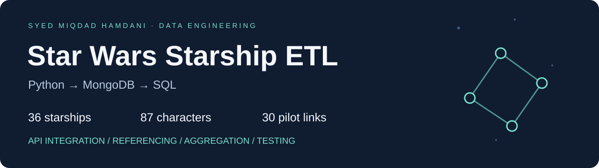
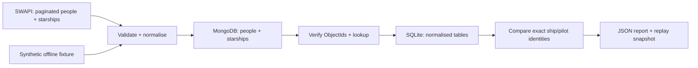

<p align="center"></p>

<p align="center">
<a href="https://github.com/miqyd0104/starship-data-pipeline/actions/workflows/ci.yml"></a>


<a href="LICENSE"></a>
</p>

# Starship Data Pipeline

### Python ETL, MongoDB referencing and relational SQL — with checks you can reproduce.

An API record is only useful if its relationships survive ingestion. This project extracts paginated people and starships from **SWAPI**, resolves pilot URLs to **MongoDB ObjectIds**, exports a normalised analytical projection to **SQLite**, and verifies that both databases represent exactly the same pilot relationships.

**Built by [Syed Miqdad Hamdani](https://github.com/miqyd0104)** as a standalone data engineering portfolio project. It demonstrates API integration, data modelling, defensive transformation, idempotent writes, automated testing and clear operational evidence.

[Run the demo](#try-it-in-two-minutes) · [Architecture](docs/architecture.md) · [Verified results](docs/results.md) · [Technical decisions](docs/decisions.md) · [Interview walkthrough](docs/walkthrough.md)

## What the verified live run delivered

| Measure | Result |
|---|---:|
| Public API people records | **82** |
| Starships | **36** |
| Ship-to-pilot relationships | **30** |
| Unresolved pilot references | **0** |
| SQLite foreign key violations | **0** |
| Automated tests, including a real MongoDB check | **56 passed** |
| Measured Python statement coverage | **96%** |

These are observed results from 26 October 2026, not hard-coded source requirements. SWAPI may change. The original classroom dataset is not bundled or required. See [run evidence and its limits](docs/results.md).

## Try it in two minutes

**Python 3.11+ is the only prerequisite for this demo. No API calls, MongoDB server or credentials are needed.**

```sh
git clone https://github.com/miqyd0104/starship-data-pipeline.git
cd starship-data-pipeline
python -m venv .venv
# macOS / Linux
source .venv/bin/activate
# Windows PowerShell: .venv\Scripts\Activate.ps1
python -m pip install -e '.[demo]'
starship-pipeline demo
```

The demo uses **three original synthetic ships and three fictional people**, with an in-memory MongoDB substitute. Its logs explicitly identify `mongomock`; it is a convenient functional demo, while the integration test verifies real MongoDB behaviour separately.

You get:

```text
artifacts/demo/
├── report.json             # Counts, quality checks, analytical metrics, pilot names
├── starships.sqlite3       # Queryable relational database
└── source-snapshot.json    # Explicit input for a later replay
```

Expected demo counts: **3 people · 3 ships · 3 pilot links**. [View an example report](examples/demo-report.json).

## Run against real MongoDB and the live API

Use an existing local MongoDB server, or start the supplied development service:

```sh
docker compose up -d --wait
```

The Compose service binds to **localhost:27018** to avoid colliding with an existing server. It is for local development. Run:

```sh
# macOS / Linux
export MONGODB_URI='mongodb://localhost:27018'
# Windows PowerShell: $env:MONGODB_URI = 'mongodb://localhost:27018'
starship-pipeline run --database starship_portfolio --output artifacts/live
```

For an existing server on port 27017, omit `MONGODB_URI` or set it accordingly. The command reads configuration from the environment; it does not automatically load `.env` files. See [.env.example](.env.example).

For Python installations that need a system trust bundle, pass `--ca-bundle /etc/ssl/cert.pem` on systems where that file exists. TLS verification is never disabled.

To replay a completed download without the API:

```sh
starship-pipeline run \
  --snapshot artifacts/live/source-snapshot.json \
  --database starship_portfolio \
  --output artifacts/replay
```

A repeat run preserves existing MongoDB person IDs and updates ships by stable source URL. Unknown extra records cause validation to fail; the pipeline does not drop collections or silently delete data. Keep different datasets in separate databases and output directories.

## How it works



- **Extract:** GET-only HTTP sessions with bounded retries, backoff, timeouts and pagination checks.
- **Transform:** Canonical source URLs are the identity; names are labels. Numeric text becomes finite, non-negative measures; unknown values stay null.
- **Load:** Unique indexes and upserts make reruns repeatable. Ships without pilots remain in the dataset.
- **Validate:** Check each BSON ObjectId, execute a real `$lookup`, enforce SQL foreign keys and compare exact ship/person URL pairs.
- **Report:** Publish counts, data-quality outcomes, source checksum, UTC timestamp, elapsed time and six analytical metrics.

The pipeline stores a deliberately small analytical projection, rather than copying every API field. It does not scrape or redistribute film opening crawls.

## Inspect the result

In **MongoDB Compass**, connect to your server and open `starship_portfolio.people` and `starship_portfolio.starships`. The ship's `pilots` array contains actual ObjectIds; `pilot_urls` retains the source identities for audit and replay.

Example lookup in Mongosh:

```javascript
db.getSiblingDB("starship_portfolio").starships.aggregate([
  {$match: {name: "Millennium Falcon"}},
  {$lookup: {from: "people", localField: "pilots", foreignField: "_id", as: "pilot_details"}},
  {$project: {_id: 0, name: 1, pilot_names: "$pilot_details.name"}}
])
```

In SQLite, a relational join retrieves the same connections:

```sql
SELECT s.name AS starship, p.name AS pilot
FROM starships AS s
JOIN starship_pilots AS link ON link.starship_url = s.source_url
JOIN people AS p ON p.source_url = link.person_url
ORDER BY starship, pilot;
```

## Test and build

```sh
python -m pip install -e '.[dev]'
ruff check .
ruff format --check .
pytest -m 'not integration' --cov=starship_pipeline --cov-fail-under=90
# Real server; a disposable, UUID-named test database is created and removed:
MONGODB_TEST_URI=mongodb://localhost:27017 pytest -m integration -v
python -m build
```

GitHub Actions runs linting, formatting, tests, the offline demo and packaging on **Python 3.11, 3.12 and 3.13**. A separate job runs the integration test against **MongoDB 8.0**. Unit tests do not call the public API. Live API verification is recorded separately from CI.

For exact dependency versions used during development, install `requirements-dev.lock`, then `pip install -e . --no-deps`.

## Project map

```text
src/starship_pipeline/
├── cli.py           # Demo/live/replay commands and safe failure messages
├── source.py        # HTTP extraction, pagination and resource identities
├── transform.py     # Pure data-quality contracts and projection
├── storage.py       # MongoDB loading, lookup, SQLite export and parity
├── pipeline.py      # Orchestration, provenance and analytical report
└── demo.py          # Original synthetic fixtures
tests/               # Behavioural unit tests + real MongoDB integration
docs/                # Architecture, modelling decisions and evidence
examples/            # Small public reports; no credentials or raw API dumps
```

## Scope and tradeoffs

This is a **batch portfolio pipeline**, with real database verification. It does not claim production scheduling, distributed processing, exactly-once delivery or a transactional commit across both databases. MongoDB writes on a standalone server are not atomic as a batch; a failed load can be resumed by rerunning. Runtime errors return a non-zero exit status and avoid logging credential-bearing connection details.

[Read the design decisions](docs/decisions.md) for the SQL projection, source identity, null handling and failure semantics. [Data sources and attribution](docs/data-sources.md) distinguish the code, original demo fixtures and upstream API content.

## License

Code and original synthetic fixtures: [MIT](LICENSE). The license does not relicense upstream SWAPI content or Star Wars names and trademarks.
