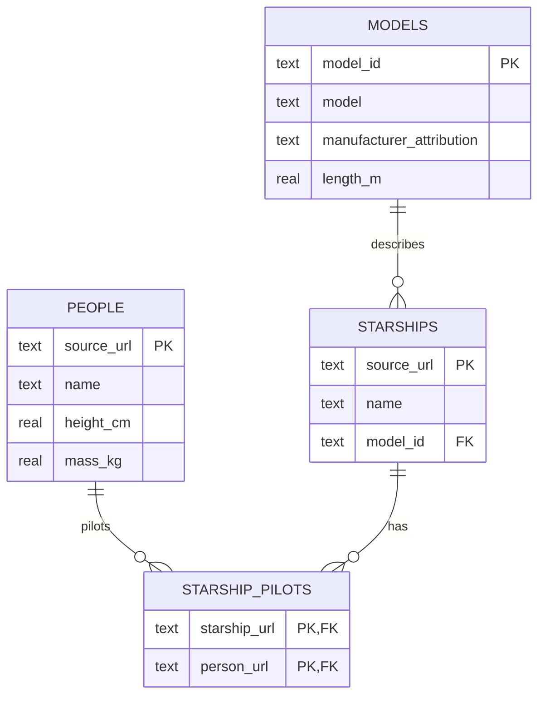

# Architecture and data contracts

The pipeline turns URL-based API relationships into native MongoDB references, then proves that a relational export preserves the same identities. `prepare()` is pure and validates the full input before the first database write.

## Boundaries

| Module | Responsibility | Failure contract |
|---|---|---|
| `source.py` | Fetch public people/starships pages with a reusable HTTP session | Reject redirects, unexpected hosts/paths, cycles, inconsistent counts and duplicate identities |
| `transform.py` | Select useful fields, canonicalise URLs and parse measures | Reject missing names, invalid measures and unresolved/duplicate pilot URLs |
| `storage.py` | Upsert MongoDB, verify lookup, export SQLite | Reject dangling/wrong pilot IDs, stale datasets and SQL identity differences |
| `pipeline.py` | Assemble evidence after successful checks | Write a report with an explicit source/backend and projection checksum |
| `cli.py` | Configure the run and return a process status | Exit 1 on handled data, HTTP, file or database errors; omit raw credential details |

## MongoDB model

`people` contains `source_url`, `name`, `height_cm` and `mass_kg`, plus MongoDB's `_id`.

`starships` contains `source_url`, `name`, `model`, raw `manufacturer` attribution, `length_m`, canonical `pilot_urls` and the corresponding BSON `pilots` array.

Both collections have a unique `source_url` index. `people._id` survives upserts, so repeated imports do not break existing pilot links. Names are never used as a unique key.

## SQLite model

The export is the analytical projection above, not a full schema for all SWAPI resources. A model specification is identified by its exact model description, manufacturer attribution and length. A hash provides a stable surrogate key; this avoids assuming that a model name alone uniquely identifies a specification. The attribution is preserved as source text, not split into invented supplier entities.

## Verification sequence

1. Validate and canonicalise the complete extracted dataset.
2. Upsert people; resolve their source URLs to ObjectIds; upsert ships.
3. Compare the exact set of stored people and ship identities against the source.
4. Check pilot IDs are BSON ObjectIds, exist, and resolve to the expected person URLs in order.
5. Execute `$lookup` and compare its returned person URL sets.
6. Export SQLite inside a transaction and run `PRAGMA foreign_key_check`.
7. Compare every SQL `(ship_url, person_url)` pair and both entity sets against the source.
8. Save the report and raw runtime snapshot for explicit replay.

A failed run exits nonzero. An earlier report in a reused directory remains an earlier report: inspect its source, timestamp and checksum; a file's presence alone is not proof that the latest attempt passed. MongoDB and SQLite do not share a distributed transaction.
