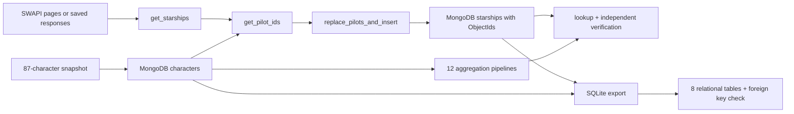
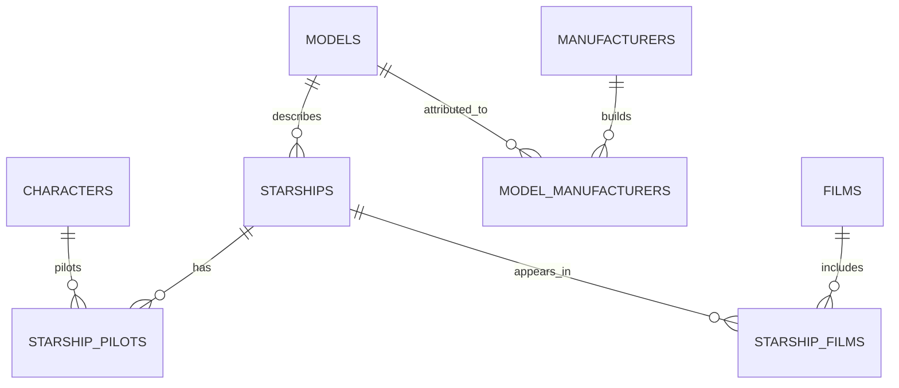

# Architecture of the original project

The implementation is the original Star Wars project, extracted into its own repository. It remains a set of readable Python scripts, not an installed CLI package.

## The identity bridge

The 87-character dataset has character names but no SWAPI person URLs. `get_pilot_ids` retrieves each person response, then requires exactly one character with the matching name. Names are therefore an explicit source-matching assumption, not a claimed globally stable identifier. Missing or ambiguous matches raise an error.

The ship stores character ObjectIds. `$lookup` joins its `pilots` array against `characters._id`; it can match several people without unwinding the array. The independent verifier checks stored pilot names against the saved API person responses.

## Reruns and write scope

The original scripts read the class `star_wars.characters` collection only when snapshot seeding is not selected. For standalone use, `run_demo.py` selects `--offline --seed-snapshot`, which populates the project collection from the included data.

All project writes go to `sparta_week06`. Character snapshot upserts match names; ship upserts match a unique URL. Existing IDs are retained on normal repeated snapshot runs. Do not switch to a source with different character IDs in the same populated project database.

All pilot matches are checked before ship writes, but the import is not a MongoDB transaction. A connection failure during writing can leave a partial load; rerun to complete the upserts. Unexpected extra ships cause verification to fail instead of being silently removed. No exactly-once delivery or cross-database transaction is claimed.

## SQL model

`schema.sql` contains the full original eight-table definition. Model specifications depend on a model key; relationships become composite-key junction rows. The loader rejects conflicting specifications for one model name. It treats comma-separated manufacturer names as separate organisations; that parsing assumption is documented rather than hidden. Character and film tables contain identity projections only.

Raw unknown values and ranges remain text in SQL. The numeric fields used by the MongoDB aggregations are converted separately inside those pipelines. SQL writes use the standard library `sqlite3` connection. The project does not depend on SQLAlchemy.

## Verification layers

1. Fifteen original unit tests exercise the function behaviour with mocked API responses and mongomock.
2. The original demo runs the import, `$lookup`, aggregation pipelines and SQL export against a real MongoDB server.
3. `verify.py` independently calculates the aggregation results in Python and checks source-to-stored pilot relationships.
4. GitHub Actions executes the original full demo twice in an isolated MongoDB environment and runs the unchanged unit tests on multiple Python versions.

MongoDB 7.0 is used for the optional Docker/CI service to avoid the hosted runner's MongoDB 8 kernel-startup compatibility issue. This setup choice does not change the original project code.
